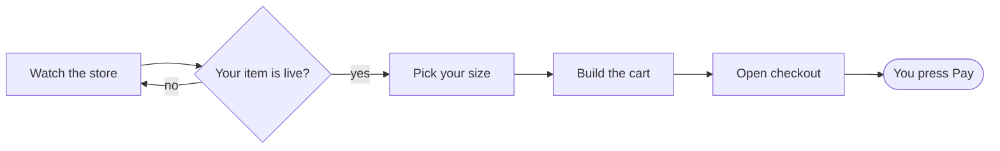

# shopify-scripting

Scripts that get you to checkout fast when a drop goes live.

They watch the store. When your item is in stock in your size, they build the cart and open checkout in your browser. **You press Pay.**

That's it. No refreshing. No size picker. No cart page.

## what it does



- Checks the store every few seconds.
- Finds your item by name.
- Takes the first size on your list that is in stock.
- Opens checkout in your normal browser.
- Stops there. Paying is your job.

## how does it find the item?

Short answer: **the store tells it.**

- Every store page loads a hidden list of its products.
- Your browser gets that list every time you open the page. You just never see it.
- The list has everything:
  - the product name
  - every size
  - which sizes are in stock
  - an ID number for each size
- The script reads the same list.
- It finds your item by **name**.
- It picks your size.
- It takes the ID that sits next to that size.
- It sends that ID the same way the "Add to Cart" button does.

So:

- Nothing is guessed.
- Nothing is hacked.
- The script reads what every visitor gets. It just reads it faster than you can click.

Why by name and not by link?

- Stores often change the links and IDs right before a drop.
- The name stays the same.

The same thing as code, for Palace:

```python
# 1. the feed: same request the site makes when you click "shop all"
raw = GET("https://usa.palaceskateboards.com/collections/all.data")
products = decode(raw)   # React Router "single fetch": flat JSON array, objects reference each other by index

# 2. keyword match on title, then size -> variant
p = next(p for p in products if all(w in p["title"].lower() for w in ["frolic", "knit", "black"]))
v = next(v for v in p["variants"]["nodes"]
         if v["selectedOptions"][0]["value"] == "Large" and v["availableForSale"])
# v["id"] == "gid://shopify/ProductVariant/4xxxxxxxxxxxxx"

# 3. ATC: the exact form post the site's own button sends
POST("https://usa.palaceskateboards.com/api/cart",
     data={"intent": "add", "merchandiseId": v["id"], "quantity": 1})   # 303 + a `cart` cookie

# 4. checkout link comes back off the cart route
checkout = decode(GET("https://usa.palaceskateboards.com/cart.data"))["root"]["data"]["cart"]["checkoutUrl"]
```

That is simplified. The real thing is [palace/palace_monitor.py](palace/palace_monitor.py).

## try it now (15 seconds)

This runs a fake shop on your computer. Nothing real is contacted. Nothing can be bought.

```bash
git clone https://github.com/DaanveerH/shopify-scripting.git
```

```bash
python3 shopify-scripting/palace/demo.py
```

You will see the shop "closed", then "open", then two carts get built.

Add `--open` to see the fake checkout pages in your browser.

## what you need

- Python 3.8 or newer. Check with `python3 --version`.
- Nothing else. No installs.
- Optional but worth it: sign in to **Shop Pay** in your browser. Then your address and card are already filled in.

## palace

**1. Make your cart file.**

```bash
cp palace/carts.example.json palace/carts.json
```

Open `carts.json`. Put in your items and sizes. It looks like this:

```json
{
  "drop_time": "11:00",
  "carts": [
    {
      "name": "Cart 1",
      "items": [
        { "title": "FROLIC KNIT BLACK", "sizes": ["L"] },
        { "title": "FROLIC NEIN CUFF BEANIE WHITE" }
      ]
    }
  ]
}
```

- `title` = the product name, with the colour.
- `sizes` = best first. Leave it out for one-size items.
- Want two orders? Add a second cart.

**2. Test it.** Nothing opens.

```bash
python3 palace/palace_monitor.py --carts palace/carts.json --dry-run --once
```

Before a drop it says `site: closed`. That is correct.

**3. Drop day.** Start it 10 to 30 minutes early.

```bash
python3 palace/palace_monitor.py --carts palace/carts.json
```

Leave it running. When checkout opens, check the order and press Pay.

More detail: [palace/README.md](palace/README.md)

## any other shopify store

First check the store works with this. Open this in a browser, with the store's address:

```text
https://STORE/products.json?limit=1
```

- You see product data: good, it works.
- You see an error page: it does not work. The store has a custom site.

Then run:

```bash
python3 shopify/shopify_monitor.py --base https://STORE --collection all --only "jacket" --size L,XL --shop-pay --dry-run --once
```

Remove `--dry-run` on drop day.

More detail: [shopify/README.md](shopify/README.md)

## don't want to do this yourself?

Use a coding agent. Open this folder in it and say what you want:

```text
Read AGENTS.md. I want to buy FROLIC KNIT BLACK in Large from Palace,
Friday 11 am Eastern. Set it up, test it, and give me the command for drop day.
```

The agent asks you a few questions. It writes the cart file. It tests it. It gives you one command.

It does not sign in for you. It does not press Pay.

The steps the agent follows are in [skills/drop-setup/SKILL.md](skills/drop-setup/SKILL.md).

## get alerts in discord

The scripts write everything that happens to a file called `events.jsonl`.

A connector reads that file and sends it somewhere. Discord is included.

```bash
python3 connectors/discord/discord_notify.py --events palace/events.jsonl --from-start --dry-run
```

Want Slack, Telegram or something else? Copy the template. It is about 40 lines.

More detail: [connectors/README.md](connectors/README.md)

## the rules

This is a helper. It is not a bot farm.

It will:

- Read the same product data the store's own pages use.
- Add **one** of each item.
- Open checkout in your own browser.
- Go slow, and slow down more if the store says to.

It will never:

- Press Pay or enter card details.
- Solve captchas or skip queues.
- Use proxies or fake accounts.
- Buy more than the store's limit.

Some stores do not allow scripts like this. Read the store's terms first. Your call.

Why the lines are drawn here: [docs/research-notes.md](docs/research-notes.md)

## does it actually work

Honest list.

Tested and worked:

- One item on a live Palace UK drop (20 Nov 2026). Found it, skipped a sold-out size, built the cart. Nothing was paid.
- One item on Palace US with normal stock (20 Nov 2026).
- A normal Shopify store during a live drop (13 Nov 2026). Got to the Shop Pay page.
- Several items and several carts, against the fake shop in this repo.

Not tested yet:

- Several items in one cart on a live Palace drop.
- Windows and Linux. Built on a Mac.

## where things are

| Folder | What |
|---|---|
| `palace/` | Palace script, example cart file, fake shop, demo |
| `shopify/` | Script for normal Shopify stores |
| `connectors/` | Discord alerts, and a template for your own |
| `skills/` | Instructions for a coding agent |
| `docs/` | [FAQ](docs/faq.md), agent setup guide, research notes |
| `tests/` | Run with `python3 -m unittest discover -s tests` |

## questions

Start with the [FAQ](docs/faq.md). It is written in plain English.

Want to add something? See [CONTRIBUTING.md](CONTRIBUTING.md).

## license

MIT. See [LICENSE](LICENSE).

Not connected to Shopify, Palace or any store. You are responsible for how you use it.
