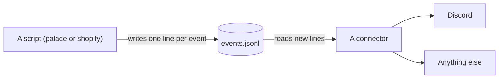

# connectors

A connector takes what a script sees and sends it somewhere else. A Discord channel. A Slack message. Your phone.



How it fits together:

- The script writes lines to a file.
- The connector reads the file.
- They never talk to each other directly.

Why that is good:

- A broken connector cannot slow down or stop a script.
- You can write a connector in any language.
- You can test a connector with an old `events.jsonl`. No drop needed.

## what is here

| Folder | What it does | Status |
|---|---|---|
| [`discord/`](discord/) | Posts events to a Discord channel | Works in print-only mode. Not yet run against a real Discord webhook. |
| [`template/`](template/) | A 40-line start for your own connector | Starter |

## the event file

Each script writes `events.jsonl` next to itself. Change the place with `--events`.

Every line is one event:

```json
{"ts": "2026-11-27T11:02:41-0500", "source": "palace", "type": "cart_built", "cart": "Cart 1", "items": ["FROLIC KNIT BLACK / Large"], "total": "168.0 USD", "checkout_url": "https://…"}
```

Every event has `ts` (your local time), `source` (`palace` or `shopify`) and `type`.

| `type` | When it happens | Other fields |
|---|---|---|
| `monitor_started` | The script starts | `site`, `dry_run`, `carts` |
| `site_state` | The shop closes, opens or gives an error | `state` |
| `product_live` | One of your items is listed | `cart`, `title`, `stock`, `url` |
| `draw_open` | A product is sold by draw (Shopify script) | `title`, `url` |
| `item_skipped` | An item is left out of a cart | `cart`, `title`, `reason`, `url` |
| `cart_built` | A cart is made and has a checkout link | `cart`, `items`, `total`, `checkout_url` |
| `checkout_opened` | Checkout was opened in the browser | `cart`, `items`, `total` |
| `cart_failed` | A cart could not be made | `cart`, `reason` |
| `monitor_done` | The script stops (Palace script) | `carts_opened` |

New fields and new types can be added later. Your connector must ignore what it does not know.

> [!WARNING]
> **`checkout_url` is like a key.** Anyone with the link can open that cart. Do not post it in a shared channel. The Discord connector leaves it out unless you ask for it.

## write your own

Copy [`template/`](template/). Rename it. Fill in one function:

```python
def handle(event):
    if event["type"] == "checkout_opened":
        send_somewhere(f"Checkout open: {', '.join(event['items'])}")
```

Test it with a recorded run. First make one:

```bash
python3 ../palace/demo.py
```

The demo prints where it saved `events.jsonl`. Play that file back:

```bash
python3 template/connector.py --events PATH-FROM-THE-DEMO --from-start --once
```

Ideas we would like to see:

- Slack
- Telegram
- Phone alerts with ntfy or Pushover
- A small web page that shows the live log

One rule. A connector **reports** what happened. It does not pay. It does not solve captchas. It does not start extra copies of a script. See [the rules](../README.md#the-rules).
