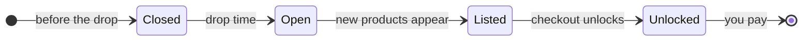
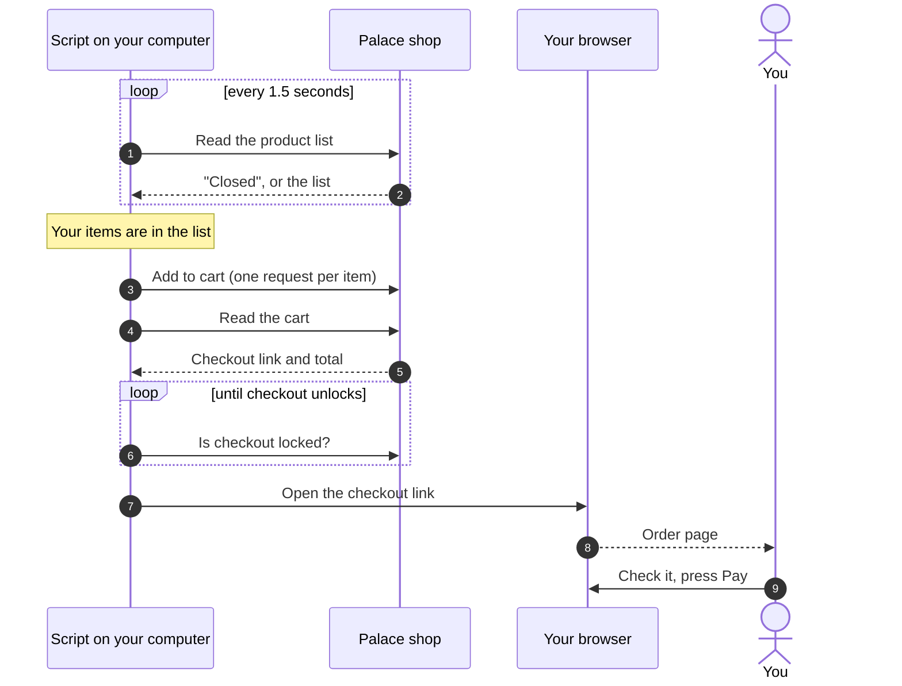
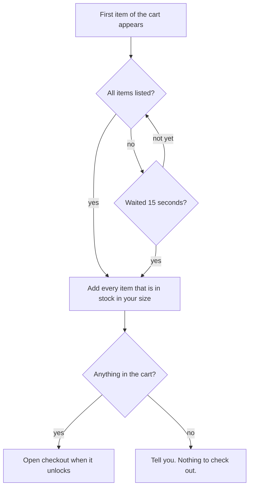

# palace

Watches the Palace web shop for the items you name. Builds your cart when they go live. Opens checkout in your browser.

**You check the order. You press Pay.**

New here? Run this first. It plays a whole drop against a fake shop on your computer. Takes 15 seconds.

```bash
python3 demo.py
```

## how a palace drop goes

Palace does not just add products to a page. The shop goes through four stages.



| Stage | What you see in a browser | What the script does |
|---|---|---|
| Closed | "Web shop re-opens at…" on every page | Checks every 10 seconds. Speeds up 3 minutes before the drop. |
| Open | The shop is back. New items may not be there yet. | Checks every 1.5 seconds for your item names. |
| Listed | Your items have pages. | Picks your size. Builds the cart. |
| Unlocked | Checkout takes orders. | Opens checkout in your browser. |

Three things to know:

- **Product links are random.** Nobody knows them before the drop. The script finds items by **name**.
- **New items can be late.** Usually 2 to 3 minutes after drop time. Once it was 13 minutes. Do not restart the script. Let it run.
- **The script uses the shop's own pages.** Shopify's public API cannot see collab items. So the script sends the same requests the website sends.

## what the script does



<details>
<summary>The technical version</summary>

| Step | Request | Notes |
|---|---|---|
| Detect | `GET /collections/<name>.data` | React Router "single fetch" data. A flat JSON array where objects point to other entries by index. `decode_route_data()` rebuilds it. When the shop is closed, the answer is a redirect to `/password`. |
| Cart | `POST /api/cart` with `intent=add`, `merchandiseId`, `quantity=1` | The same request the Add to Cart button sends. One cookie jar per cart. One request per item. Success is a `303` and a `cart` cookie. |
| Read back | `GET /cart.data` with the same cookies | Gives `totalQuantity`, `checkoutUrl` and the total. The script compares the item IDs in the cart with what it sent. The shop accepts an add for a sold-out size and then drops it. |
| Gate | `GET <checkout host>/password` | `200` while locked. A redirect when open. |

The script's cart is separate from your browser's cart. You can still add to cart by hand in the browser as a backup.

</details>

## when does a cart go?

A cart with several items has to decide when to stop waiting.



- All items are there: it goes right away.
- Some are missing: it waits 15 seconds, then goes with what it has.
- An item is sold out in your sizes: it is left out. The log names it and gives you the link.
- Carts are built in the order you list them. Put the most important cart first.
- Each cart opens the moment it is built. The first cart does not wait for the second.

## your cart file

Copy the example. Edit the copy.

```bash
cp carts.example.json carts.json
```

`carts.json` stays on your computer. Git ignores it.

```json
{
  "drop_time": "11:00",
  "carts": [
    {
      "name": "Cart 1",
      "items": [
        { "title": "FROLIC KNIT BLACK", "sizes": ["L"] },
        { "title": "POLARTEC 200 RUGBY CREW ULTIMATE GREY", "sizes": ["L", "XL"] }
      ]
    },
    {
      "name": "Cart 2",
      "items": [
        { "title": "FROLIC NEIN CUFF BEANIE WHITE" },
        { "title": "BASICALLY A TECH DECK BLACK" }
      ]
    }
  ]
}
```

For each item:

| Field | What to put | Example |
|---|---|---|
| `title` | The product name with the colour. Every word must be in the shop's title. Capitals and dashes do not matter. | `"DR PALACE T-SHIRT GREY MARL"` |
| `sizes` | Your sizes, best first. Leave it out for one-size items. | `["L", "XL"]` |
| `exclude` | Optional. Skip products with these words. | `["kids"]` |

Write sizes as `XS, S, M, L, XL, XXL, 3XL`. The script changes them to Palace's names.

For the whole file:

| Field | Default | What it is |
|---|---|---|
| `drop_time` | `"11:00"` | Drop time on **your computer's clock**. 24-hour. |
| `collections` | `["all"]` | Which shop pages to read. You can add a category, for example `"jackets"`. |
| `wait_seconds` | `15` | How long a cart waits for its other items. |
| `browser` | `"Google Chrome"` | The browser to open checkout in (Mac only). A cart can set its own. |
| `open_missing` | `false` | Also open the page of each item that was left out. |
| `shop_pay` | `false` | Add Shopify's Shop Pay hint to the checkout link. Skips one redirect. Not yet tried on a live Palace shop, so it is off by default. |

How names are matched:

- Whole words only. `TECH` does not match `POLARTEC`.
- Two products match? The one with the fewest extra words wins. The log tells you.
- No match after the shop opens? The log prints the closest names it can see. Check for a typo.

**One of each item.** You cannot list the same item twice. Not in one cart. Not across carts.

### two carts, one browser

Each cart opens in its own tab. Pay the first tab. Then pay the second.

Want them fully apart? Give the second cart another browser. That browser must also be signed in to Shop Pay.

```json
{ "name": "Cart 2", "browser": "Safari", "items": [ … ] }
```

## run it

**1. Write your cart file.** See above.

**2. Test.** Nothing opens. Before a drop you get `site: closed`. That is correct.

```bash
python3 palace_monitor.py --carts carts.json --dry-run --once
```

**3. Drop day.**

```bash
python3 palace_monitor.py --carts carts.json
```

Only one item? You do not need a file:

```bash
python3 palace_monitor.py --match "frolic,knit,black" --size L,XL
```

<details>
<summary>All the options</summary>

| Option | Default | What it does |
|---|---|---|
| `--carts FILE` | | Your cart file |
| `--match WORDS` | | One item: words that must all be in the title |
| `--size L,XL` | | One item: your sizes, best first |
| `--exclude WORDS` | | One item: skip titles with these words |
| `--collections all,jackets` | `all` | Shop pages to read |
| `--drop HH:MM` | `11:00` | Drop time on your clock |
| `--wait SECONDS` | `15` | How long a cart waits for its other items |
| `--interval SECONDS` | `1.5` | Time between checks. Minimum 1. |
| `--lock-wait SECONDS` | `120` | Longest wait for checkout to unlock. After that it opens anyway. |
| `--browser NAME` | `Google Chrome` | Mac browser. `default` = your default browser. |
| `--user-agent` | `browser` | How the script names itself to the shop. `honest` = the real project name. See [research notes](../docs/research-notes.md#1-do-not-pretend-to-be-something-you-are-not). |
| `--shop-pay` | off | Same as `shop_pay` in the cart file |
| `--dry-run` | | Never open a browser |
| `--test-cart` | | With `--dry-run`: build real carts on the shop. Still opens nothing. |
| `--once` | | Check one time, then stop |
| `--log FILE`, `--events FILE` | next to the script | Where the log and the [event file](../connectors/README.md) go |

An option on the command line beats the same setting in the cart file.

</details>

<details>
<summary>Other regions</summary>

The US shop is the default. For another region, set two variables. This was tested for the UK:

```bash
PALACE_SITE=https://palaceskateboards.com PALACE_CHECKOUT=https://checkout.palaceskateboards.com python3 palace_monitor.py --carts carts.json --dry-run --once
```

Palace sends visitors to the shop for their location. From a US connection, the US shop needs an `Accept-Language` header and the UK shop must not get one. The script handles both.

The EU, Canada, Australia, Japan and Korea shops (`eu.`, `ca.`, `au.`, `jp.`, `kr.`) are not tested. If the log says `site: closed (redirects to https://…)` and points at another region, change `HEADERS` in the script.

</details>

## let an agent do it

Use a coding agent? You do not have to write the file. Open the repo in the agent and say what you want:

```text
Set up the Palace monitor for Friday 11:00 am Eastern.
Cart 1: FROLIC KNIT BLACK in Large, POLARTEC 200 RUGBY CREW ULTIMATE GREY in Large.
Cart 2: FROLIC NEIN CUFF BEANIE WHITE and BASICALLY A TECH DECK BLACK.
Chrome is signed in to Shop Pay. Do a dry run and give me the drop-day command.
```

The agent will:

1. Ask what it does not know. Sizes, backup sizes, drop time, which browser has Shop Pay.
2. Write `palace/carts.json`.
3. Run the demo and a test. Show you the log.
4. Give you one command for drop day.

It does not sign in for you. It does not type card details. It does not press Pay.

Its instructions are in the [drop-setup skill](../skills/drop-setup/SKILL.md).

## drop day checklist

- [ ] Your browser is open and **signed in to Shop Pay**. Address and card are saved.
- [ ] 30 minutes before: run the test. `site: closed` is what you want.
- [ ] Start the real run in a terminal you can see. **One copy only.**
- [ ] Keep the computer awake.
- [ ] Checkout opens: check item, size, total, address. Press Pay.
- [ ] A queue or captcha at checkout is the store's. Wait, or clear it yourself.

The script stops by itself when every cart is opened or has nothing left to try.

## reading the log

Everything on screen is also saved in `monitor.log`.

| You see | It means |
|---|---|
| `site: closed (redirects to /password)` | Normal before a drop. It is waiting. |
| `site: OPEN` | The shop is back. It is looking for your items. |
| `LIVE: … \| Medium=in, Large=out` | One of your items is listed. Shows stock for each size. |
| `not in the shop yet: "…". Closest titles right now: …` | No product has that name yet. Check the suggestions for a typo. |
| `[Cart 1] leaving out …: your sizes are sold out` | That item is skipped. The rest of the cart goes on. |
| `[Cart 1] cart built in 0.4s with 2 item(s), 316.0 USD` | The cart is made. |
| `[Cart 1] cart is ready but Palace's checkout is still locked` | Waiting for checkout to unlock. Do nothing. |
| `[Cart 1] CHECKOUT OPENED in Google Chrome` | Your turn. |

## when something goes wrong

| You see | It means | Do this |
|---|---|---|
| `site: closed` long after drop time | The shop has not reopened | Wait. Check Palace's own channels for a delay. |
| `not in the shop yet` for one item, others are live | The name in your file is wrong | Compare with the suggested names. Fix `carts.json`. Restart. |
| `cart failed (try 1 of 3)` | The shop refused or timed out | It tries again. After 3 tries it opens the product pages for you. |
| `not in the cart: … (refused)` | The shop took the add, then dropped the item. Usually sold out. | Use the link in the log to try by hand. |
| Checkout shows a password page or the home page | Checkout opened while the shop was still locked | Open the link again after the shop reopens. |
| `HTTP 429`, `430` or `503` | The shop says slow down | The script slows down by itself. Do not lower `--interval`. |
| Two carts but you see one tab | The second checkout opened in a new tab | Look at the tab bar. |

## what is tested

Worked:

- **20 Nov 2026, Palace UK, live collab drop.** Found the item. Skipped a sold-out first size. Built a real cart for the second size. Checkout was open. A test checkout got to Shop Pay in under a second. Nothing was paid.
- **20 Nov 2026, Palace US.** Found items and built a cart with normal stock. Saw the closed shop correctly.
- **Several items and several carts.** Against the fake shop in this folder. Run `python3 -m unittest discover -s ../tests`.
- **Honest name (`--user-agent honest`).** Palace US gives the same answer as for a browser name while the shop is closed.

Not tested yet:

- Honest name while the shop is open.
- The Shop Pay hint (`shop_pay`) on a Palace checkout link.
- Several items in one cart on a live Palace drop.
- Two checkouts open in one browser with Shop Pay.
- Regions other than US and UK.
- Windows and Linux.
- A checkout queue or captcha.

## files here

| File | What it is |
|---|---|
| [`palace_monitor.py`](palace_monitor.py) | The script |
| [`carts.example.json`](carts.example.json) | A cart file to copy |
| [`demo.py`](demo.py) | Plays a whole drop against the fake shop |
| [`fake_shop.py`](fake_shop.py) | The fake shop. Runs on your computer. |
