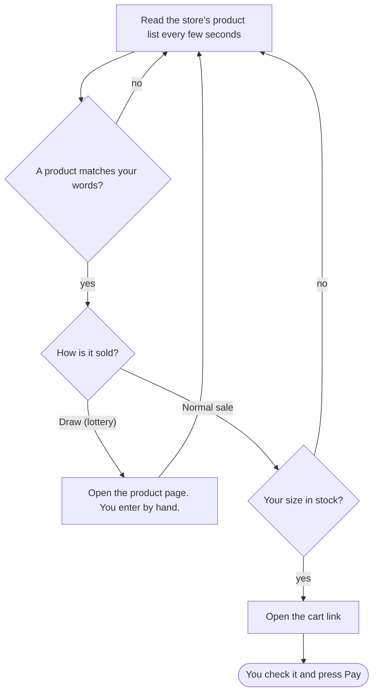

# shopify

For normal Shopify stores. It watches for your product. When your size is in stock, it opens a link that goes to checkout with the item already in the cart.

**You check the order. You press Pay.**

Is the store Palace, or another store with a custom site? This script will not work there. Use [`../palace/`](../palace/README.md).

## will it work on my store?

Open this in a browser. Put the store's address where it says `STORE`.

```text
https://STORE/products.json?limit=1
```

- You see product data (text that starts with `{"products":`): it works.
- You see an error page, or you get sent somewhere else: it does not work.

## how it works



Two Shopify features do the work:

- **Product lists.** `/products.json` shows the store's products as plain data. Newest first.
- **Cart links.** `STORE/cart/12345:1` means "a cart with one of item 12345". It goes straight to checkout.

A **draw** is a lottery for the right to buy. Speed does not help. The script opens the page so you can enter by hand. It keeps watching, because stores sometimes change a draw to a normal sale.

## run it

**1. Test with something that is in stock today.**

```bash
python3 shopify_monitor.py --base https://STORE --collection all --only "WORD-FROM-A-TITLE" --size M --shop-pay --dry-run --once
```

It prints a checkout link. Open the link one time. Check that the item is correct. Close the tab. Do not pay.

Then empty the cart: open `https://STORE/cart/clear`.

**2. Drop day.**

```bash
python3 shopify_monitor.py --base https://STORE --collection COLLECTION --title-words "word1,word2" --only "jacket" --exclude "kids" --size L,XL --shop-pay --browser "Google Chrome"
```

| Option | What it does |
|---|---|
| `--base` | The store's address |
| `--collection` | The collection to watch. It is the part after `/collections/` in the drop page's address. |
| `--title-words`, `--vendor` | Also check the 60 newest products in the store for these words or this brand. Use one of them with `--collection`. Drops sometimes go live before they are added to the collection. |
| `--only` | Only act on titles with one of these words. Without it, every match opens a checkout. |
| `--exclude` | Never act on titles with these words. Watch for near-copies, for example kids' sizes. |
| `--size` | Your sizes, best first |
| `--bundle` | Items that go live in the same check go in one checkout |
| `--shop-pay` | Send the cart link straight to Shop Pay |
| `--also`, `--also-browser` | A second, less important item. It opens in a different browser. |
| `--handle` | Check one known product address directly |
| `--user-agent` | How the script names itself to the store. `browser` is the default. `honest` uses the real project name. Tested with `honest` on Shopify's demo store. |
| `--dry-run`, `--once` | Print links and open nothing. Check one time and stop. |

## easy mistakes

- **A cart link replaces the cart in that browser.** Open one link per browser. That is why a second item goes to a second browser.
- **Do not reuse product links or item IDs from the day before.** On one drop the store took the pages down at night. It put them back with new links and new IDs, four minutes before drop time. Match by words.
- **A collection that is not live looks empty.** It gives a `404` page and an empty list. The script reads both as "not live yet".
- **Accents do not matter.** "Pokémon" matches `pokemon`.

## when something goes wrong

| You see | It means | Do this |
|---|---|---|
| `collection not published yet (404)` | Normal before a drop | Wait |
| `DRAW …: lottery entry, not first-come` | The product is sold by draw | Enter by hand on the page that opened |
| The cart link gives `410` | A draw product, or the store has a custom site | Enter by hand. For custom sites see [`../palace/`](../palace/README.md). |
| `WAIT …: your sizes not in stock` | Listed, but not in your sizes | It keeps watching for a restock |
| HTTP `429`, `430` or `503` | The store says slow down | The script slows down by itself. Do not lower `--interval`. |
| Checkout shows a normal form, not Shop Pay | The browser is not signed in to Shop Pay | Sign in before the drop |

The full setup guide is [`../docs/agent-setup.md`](../docs/agent-setup.md). It also covers stores that this script does not.
